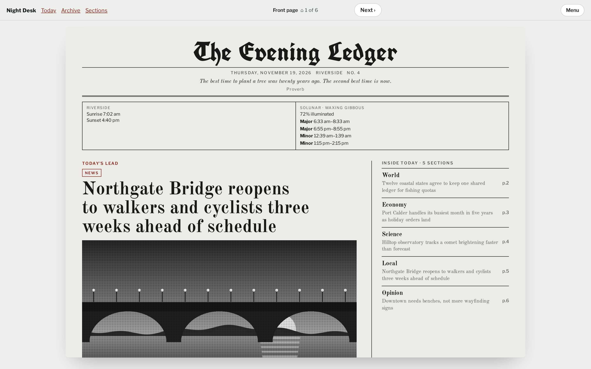
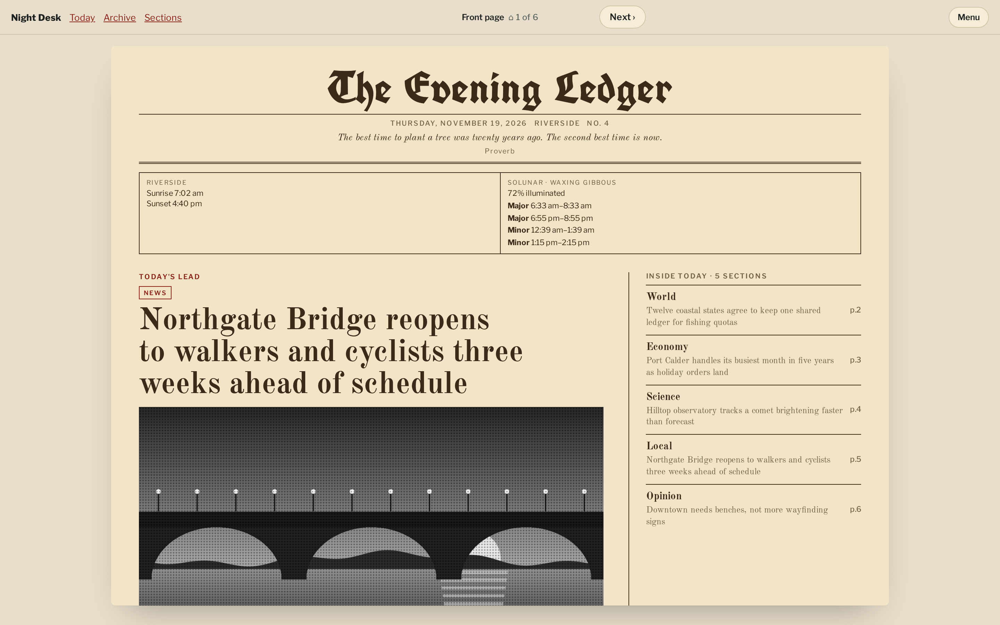
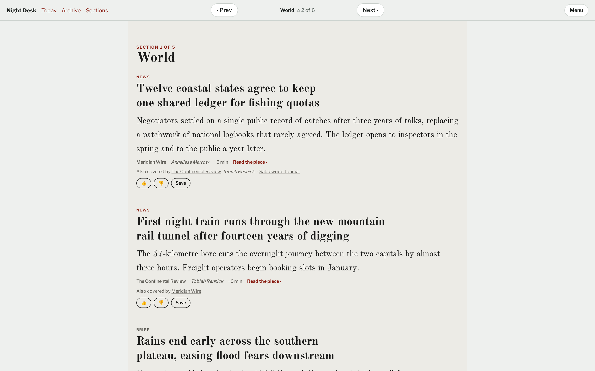
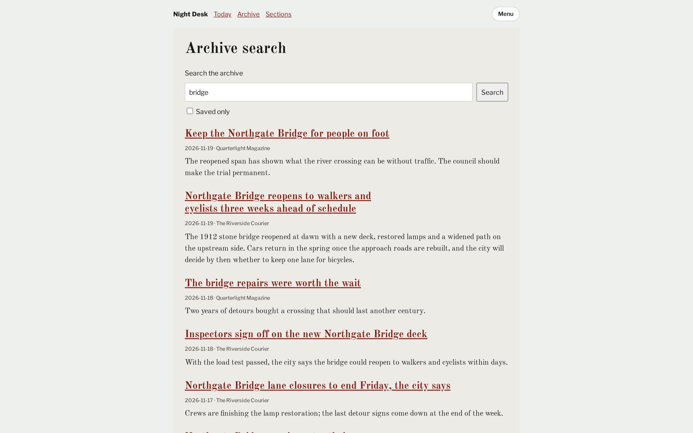

<h1 align="center">
  <picture>
    <source media="(prefers-color-scheme: dark)" srcset="docs/brand/wordmark-dark.svg">
    
  </picture>
</h1>

<p align="center"><em>A daily paper with a circulation of one.</em></p>

<p align="center">
  <a href="https://github.com/irashack/night-desk/actions/workflows/ci.yml"></a>
  <a href="https://github.com/irashack/night-desk/releases"></a>
  <a href="LICENSE"></a>
</p>

Night Desk is a small, self-hosted service that puts together a personal daily
newspaper and delivers it to a reader app on your phone and desktop. It gathers
your sources overnight, drafts or accepts an edition, checks it against those
sources and publishes on a deadline. Your 👍, 👎 and saves are stored and handed
to your agent through the API, so it can take them into account.

An AI agent can write the paper, review drafts Night Desk writes, or stay out of
it entirely. Every role uses the same documented protocol, and several readers can
share one server, each seeing only their own paper. Without an agent, Night Desk
writes the paper itself with a model you choose (a local one through Ollama, any
OpenAI-compatible API, or Claude).

<p align="center">
  
  
</p>

> **Status: beta.** Night Desk runs real papers every morning, but it is new to the
> public and pre-1.0: expect rough edges. Editions and stored data keep the
> [upgrade promise](docs/upgrading.md).

## What it does

- **A paper that is yours.** Sections, sources (RSS/Atom feeds, OPML,
  site-limited Google News), a masthead, a deadline in your timezone, editorial
  briefs, and the look of a broadsheet: Pages, List and Reader layouts in light,
  sepia and dark.
- **Agents at the depth you choose.** `author`: your agent picks, writes and
  publishes. `reviewer`: Night Desk drafts with the models you configure (any
  OpenAI-compatible API or Claude) and your agent approves, edits, cuts or sends
  back. `none`: Night Desk drafts with your models and publishes on schedule, with
  no agent involved.
- **Checked against its sources.** Before an edition is published, code (not a
  model) compares its numbers, names and quotes with the stored snapshots of the
  articles it cites, and flags repeats, wire copy and claims it cannot find. The
  checks are advisory: warnings travel with the edition, and a story whose page
  was never fetched is marked unverified rather than passed.
- **A real reader app.** An installable PWA with offline reading of the latest
  edition, a reading view that sets a story in the paper's own type from the
  worker's stored copy (with its text size and your place kept per device),
  archive search, saved items, per-item feedback, push notifications when
  the paper lands, and a complete no-JavaScript fallback.
- **Coverage lean, if you want it.** Sections can show which side of the spectrum
  covered a story and flag blindspots, from a ratings file you provide.
- **Built to be safe to run.** One Go binary and SQLite. Fetching and model calls
  run in a separate, unprivileged worker that never opens the database. Keys are
  paper-scoped with explicit capabilities, and private network addresses are
  refused.
- **Sign-in your way.** Local accounts with passwords, passkeys and invite links
  (the default, no identity provider needed), your OIDC provider, a trusted
  reverse proxy such as Authelia or oauth2-proxy, or no sign-in at all for one
  reader on a private network.

<p align="center">
  
  
  
</p>

## Quick start

You need a container runtime, and an HTTPS reverse proxy for other devices to
reach it. Images are published for linux/amd64 and linux/arm64 at
`ghcr.io/irashack/night-desk`; pin one by digest.

```sh
export NIGHTDESK_IMAGE='ghcr.io/irashack/night-desk@sha256:…'   # the release notes list the image digest
export NIGHTDESK_DIR="$PWD/nightdesk"
install -d -m 0700 "$NIGHTDESK_DIR"

# Create a configuration, a migrated database and one agent key. Use your HTTPS
# address for --public-url, or leave it out to try it at http://localhost:8080.
docker run --rm --user "$(id -u):$(id -g)" \
  --mount "type=bind,src=$NIGHTDESK_DIR,dst=/data" \
  "$NIGHTDESK_IMAGE" init --dir /data --paper daily --masthead 'The Daily' --timezone America/Chicago

docker run -d --name nightdesk --restart unless-stopped --user "$(id -u):$(id -g)" \
  --read-only --cap-drop ALL --security-opt no-new-privileges \
  --publish 127.0.0.1:8080:8080 \
  --mount "type=bind,src=$NIGHTDESK_DIR,dst=/data" \
  "$NIGHTDESK_IMAGE" serve --config /data/config.yaml

# The first visit asks for this one-time setup code, then creates your account.
docker logs nightdesk 2>&1 | grep setup_code
```

Open the address, enter the setup code and choose a username and password. Invite
the rest of the household from **Readers** in the Menu. To sign in with an OIDC
provider (Pocket ID, Authentik, Keycloak and others), a reverse proxy's header, or
not at all, pass `--auth oidc`, `--auth proxy` or `--auth none` to `init`; the
[install guide](docs/install.md) and [Reader sign-in](docs/configuration.md#reader-sign-in)
cover each.

**Next.** A new paper's `agent_role` is `author`, so it stays blank until your
agent publishes an edition (the install guide has a one-line
[sample edition](docs/install.md#first-paper) to check the reader first); see [Integrating an agent](integrations/README.md).
For Night Desk to write the paper on its own, add sources to its sections, set
`agent_role: none` and a `deadline`, and run the
[gathering worker with a model](docs/install.md#gathering-and-optional-models).

The [install guide](docs/install.md) covers every step, including Podman, the
gathering worker, models, backups and upgrades. Prefer a binary? Each
[release](https://github.com/irashack/night-desk/releases) has tarballs with build provenance for
Linux and macOS, or run `go install github.com/irashack/night-desk/cmd/nightdesk@latest`.

Want to look around first? The image serves a fictional demo paper with nothing to
configure, no keys and no network access, and keeps nothing when it stops:

```sh
docker run --rm -p 127.0.0.1:8080:8080 ghcr.io/irashack/night-desk demo
```

Then open <http://localhost:8080>. It has four days of editions, the reading view,
archive search and the section editor; `nightdesk demo` does the same from a
binary.

## Documentation

| | |
|---|---|
| [Install guide](docs/install.md) | A first paper, the worker, models, backups and upgrades. |
| [Configuration and protocol reference](docs/configuration.md) | Every server and paper setting, the reader, editions, webhooks and events. |
| [Integrating an agent](integrations/README.md) | HTTP and OpenAPI, MCP over stdio, webhooks, and the conformance kit. |
| [Hermes integration](integrations/hermes/README.md) | A complete agent plugin and its writing pipeline. |
| [Design](docs/design.md) | How Night Desk is built, and why. |
| [Roadmap](docs/roadmap.md) | What comes next. |
| [Upgrading](docs/upgrading.md) | The compatibility promise. |
| [OpenAPI](docs/reference/openapi.json) · [edition schema v1](schema/edition-v1.json) · [v2](schema/edition-v2.json) | The published contracts. |

## Commands

| Command | What it does |
|---|---|
| `nightdesk demo` | Serves a fictional demo paper with nothing to configure (`--listen`, default `:8080`). |
| `nightdesk serve` | Runs the server: agent API, reader, scheduler and webhook delivery. |
| `nightdesk migrate` | Applies the embedded, forward-only database migrations. |
| `nightdesk key` | `issue`, `list` and `revoke` paper-scoped keys; `--worker` selects `read,gather,draft`. |
| `nightdesk accounts` | `list` local accounts, or print an `invite` or `reset <username>` link; `remove <username>`. |
| `nightdesk backup <dir>` | Writes a consistent SQLite copy and the retained image store. |
| `nightdesk init --dir <dir>` | Creates a first configuration, migrated database and agent key. `--auth` picks the sign-in mode (`local` by default) and `--public-url` the address readers open. |
| `nightdesk check --config <file>` | Strictly validates the whole configuration; opens no database and contacts no provider. With `--worker-config <file>` it also validates the worker config and estimates the monthly drafting cost from tier prices. |
| `nightdesk gather --server <url> --key-file <file>` | Runs the worker; add `--worker-config` to gather and draft, `--once` for one pass. |
| `nightdesk mcp --server <url> --key-file <file>` | Runs the HTTP-only stdio MCP client. |
| `nightdesk conformance` | `list` or `serve` the scripted scenarios used to test an integration. |
| `nightdesk quality --config <file>` | Prints the operator quality report (`--days N`, `--json`): deadlines, holds, unreviewed editions, send-backs, warnings and source checks by rule, drafting runs, tokens and estimated cost, article fetch health by host, review turnaround and feedback trend. The same aggregates are on the optional `/operator` page. |
| `nightdesk ratings import --name --url --license --attribution --out <file> <ratings.csv>` | Turns an `outlet,domain,lean[,factuality]` CSV into the ratings file `lean.ratings_file` reads, with the same validation; refuses to overwrite without `--force`. |
| `nightdesk prompts list\|reset --worker-config <file> [name]` | Lists the drafting prompts with their versions and whether each is overridden, or removes one override so the embedded default applies. |
| `nightdesk validate <edition.json>` | Validates an edition offline with the server's rules. |
| `nightdesk version` | Prints the Night Desk version. |

Administrative commands default to `nightdesk.yaml` and accept `--config <file>`.

## Contributing

Bug reports, ideas and pull requests are welcome; see
[CONTRIBUTING.md](CONTRIBUTING.md). Please report security problems privately as
described in [SECURITY.md](SECURITY.md).

## Licence

MIT © Ira Shackelford. Fonts, ported code and credited ideas are listed in
[THIRD_PARTY_NOTICES.md](THIRD_PARTY_NOTICES.md) and the
[roadmap's credits](docs/roadmap.md#credits).
